<p align="center">
  
</p>

<p align="center">
  <a href="https://github.com/dhananjay1906">
    
  </a>
</p>

<p align="center">
  <a href="https://www.linkedin.com/in/dj1906/"></a>
  
  
</p>

---

### `> whoami`

```python
class Dhananjay(SoftwareEngineer):
    role      = "Full-Stack Engineer · Government tech"
    builds    = ["Full-stack web apps", "REST APIs", "AI / LLM tools"]

    stack     = {
        "backend":  ["Python", "FastAPI", "SQL", "PostgreSQL"],
        "frontend": ["React", "TypeScript", "JavaScript"],
        "ai":       ["LangGraph", "RAG", "MCP", "Claude", "Gemini"],
        "cloud":    ["Azure", "AWS", "Firebase", "GitHub Actions"],
    }

    shipped   = [
        "Record searches 60% faster by fixing slow SQL queries",
        "Secure PII document storage with role-based access + retention rules",
        "RAG agent with a 0.00% PII leak rate across 182 eval prompts",
    ]

    workflow  = "AI-first with Claude Code + GitHub Copilot"
    education = "MS Computer Science · AWS Certified"
    open_to_work = True
```

---

### 🛠️ Toolbox

<p align="center">
  <br/>
  
</p>

---

### 🚀 Featured builds

<table>
<tr>
<td width="33%" valign="top">

#### 🩻 [Onboarding X-Ray](https://github.com/dhananjay1906/onboarding-xray)
Alt+click any button in a running app and trace it all the way down: **React component → API call → FastAPI route → Python functions → DB tables**, each step explained by Gemini Nano **on-device**.

`TypeScript` `Chrome MV3` `FastAPI` `Firebase AI`

</td>
<td width="33%" valign="top">

#### 🛡️ [RedactRAG](https://github.com/dhananjay1906/RedactRAG)
Document Q&A agent that masks PII locally **before** anything reaches the LLM.
**0.00% leak rate** across 182 prompts · **32/32** cited answers correct · served as an **MCP** server.

`Python` `LangGraph` `pgvector` `Presidio` `Claude`

</td>
<td width="33%" valign="top">

#### 🛋️ [CouchSync](https://github.com/dhananjay1906/CouchSync)
Self-hosted watch parties for up to 4: synced playback, a live camera + mic sidebar inside the video page, chat and reactions. No subscriptions.

`JavaScript` `Node.js` `WebRTC` `Chrome Ext`

</td>
</tr>
</table>

---

### 🧭 Currently

```diff
+ Building privacy-first AI tooling for teams with sensitive data
+ Exploring MCP servers and on-device LLMs
! Open to Full-Stack · Python · AI Engineer roles (remote-friendly)
```

---

<p align="center">
  
</p>
